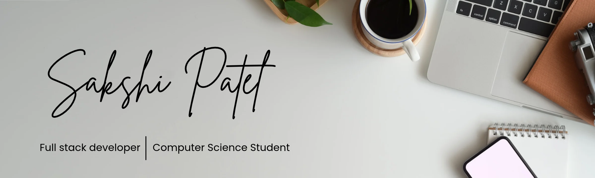
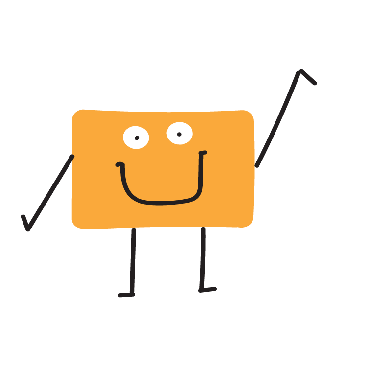

<!-- ## Hello, I'm Sakshi

🎓 2nd year BTech Student  
🐍 Beginner level Python Coder  
⚡ Exploring Backend development

## 📚 What I'm Learning
- Python basics
- Backend development
- Problem solving

## 🎯 Goal
To improve my coding skills and build strong fundamentals step by step. -->

 

<h2>  Hey there! I’m Sakshi</h2>

<!-- ## 👋 &nbsp;Hey there! I'm Shailly -->
<h3 id="-about-me">👩🏻‍💻 &nbsp;About Me</h3>

💡 &nbsp;I like to explore new technologies and turn ideas into interactive web experiences and data-driven projects. 
🎓 &nbsp;I’m currently a B.Tech Computer Science student at Ajay Kumar Garg Engineering College, Ghaziabad. 
🌱 &nbsp;I’m on track for learning more about App Development, and Full-Stack Development. 
✍️ &nbsp;In my free time, I enjoy painting, sketching, writing stories, and listening to music. 
💬 &nbsp;Feel free to reach out to me for collaboration, learning together, or just for some interesting discussion. 
✉️ &nbsp;You can shoot me an email at <a href="mailto:sakshipatel07012008@gmail.com">sakshipatel07012008@gmail.com</a>! I’ll try to respond as soon as I can. 
📄 &nbsp;Please have a look at my 
<a href="assets/resume.pdf" target="_blank">Resume</a> for more details about me. I’m open to feedback and suggestions!

 

<h3>🛠 &nbsp;Tech Stack</h3>

<table>
  <tr>
    <td valign="middle" width="65%">
      

        
        
        
        
        
        
        
        
        
      

    </td>
    <td valign="middle" width="35%" align="center">
      
    </td>
  </tr>
</table>

<h3 id="️-github-analytics">⚙️ &nbsp;GitHub Analytics</h3>

 

<h3 id="-connect-with-me">🤝🏻 &nbsp;Connect with Me</h3>

<!--  -->

<!--  -->

Credits: <a href="https://github.com/Sakshipatel-2008">Sakshi Patel</a>

Last Edited on: 31/10/2026

